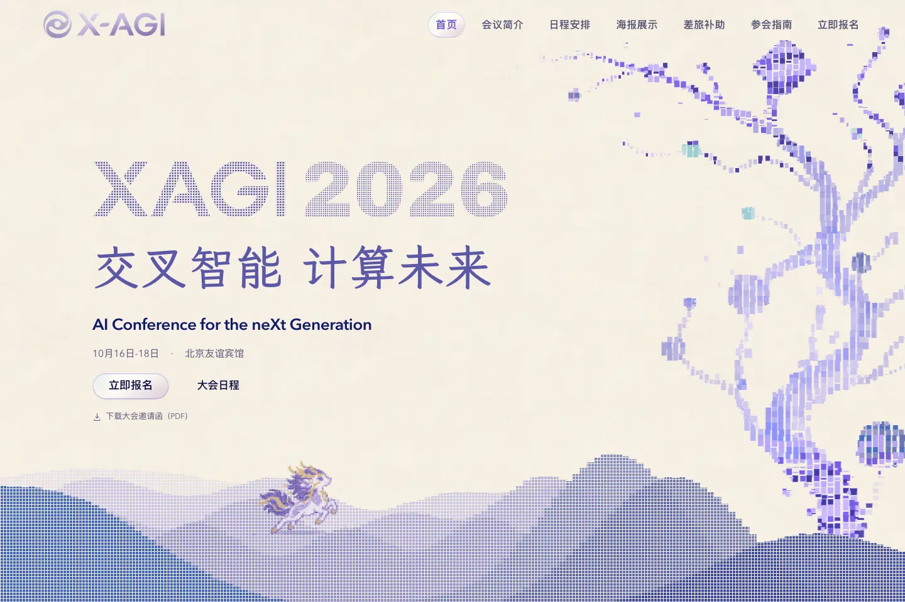

# X-AGI 2026 · 交叉智能大会

**交叉智能，计算未来。**

X-AGI 2026 大会官网，收录会议介绍、日程、嘉宾报告、研究海报与历届影像。

[访问官网](https://www.x-agi.cc) · [大会日程](https://www.x-agi.cc/schedule/) · [研究海报](https://www.x-agi.cc/poster/) · [2025 归档](https://www.x-agi.cc/2025/)

## 2026 大会

| 项目 | 信息 |
| --- | --- |
| 时间 | 2026 年 10 月 16 日至 18 日 |
| 地点 | 北京友谊宾馆 |
| 主题 | AI Conference for the neXt Generation |
| 发起方 | 统计之都、FAI（人工智能基础研究） |

X-AGI 起源于统计之都发起的中国 R 会议，2026 年为第十九届。
“X”代表未知、交叉与探索。
本届关注 AI4Math、AI4Science、语言模型、Agent、生成建模、机器学习理论等方向，并通过 Rising Stars Poster 展示青年研究者的成果。
完整介绍与组织单位见[会议简介](https://www.x-agi.cc/about/)。

## 视觉与交互

[](https://www.x-agi.cc)

网站将纸面的温润质感与计算图形结合，用暖纸色、深靛文字和蓝紫色结构形成统一的视觉语言。
点阵字标、粗体年份与中文楷体构成首屏的标题层级，玻璃材质集中用于导航和交互控件。

- **像素树与概率地形**：树上的像素自下而上翻转，层叠的山丘随指针轻微变化，麒麟沿场景路径运动。
- **液态玻璃控件**：导航与行动按钮使用移动镜片连接选中状态，响应鼠标、键盘焦点与触摸输入。
- **历届影像画廊**：17 场活动的照片以横向画廊展开，波形目录对应活动位置，保留照片比例和图注。
- **研究海报查看器**：展示作者提交的原作，支持搜索、筛选、点击放大与细节查看。
- **响应式构图**：手机端采用山丘上的麒麟场景与紧凑导航，保留键盘操作、焦点提示和减少动态效果模式。

截图来自 2026 年 10 月 18 日的正式网站。
手机端截图、交互机制与源码入口见[设计与交互指南](docs/agent-design-guide.md)。

## 本地预览

网站使用 Astro 7、TypeScript 与原生 CSS / DOM 交互，运行环境为 Node.js 24。

```bash
npm ci
npm run dev
```

打开 [localhost:4321](http://localhost:4321) 查看网站。

## 项目文档

- [设计与交互指南](docs/agent-design-guide.md)：视觉语言、组件机制与源码映射。
- [设计规范](docs/2026-design-system.md)：颜色、排版、材质、动效与无障碍约定。
- [网站维护指南](docs/maintenance.md)：内容来源、本地开发、验证与发布。
- [2026 定版记录](docs/site-freeze-2026-10-18.md)：定版标签 `x-agi-2026-final` 与验证记录。

仓库同时保存独立的 [2025 静态归档](public/2025/)。
