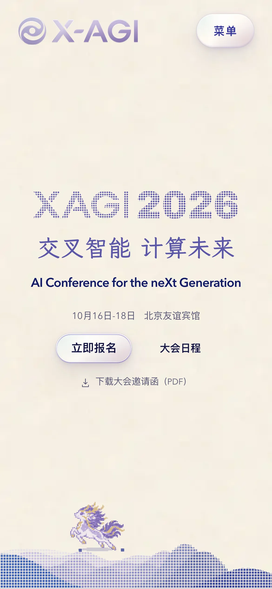

# Agent 设计与交互指南

本指南供 coding agent 和 design agent 理解、修改或迁移 X-AGI 2026 网站的设计机制。
先确定任务涉及的组件，再读取对应入口、运行时、样式和测试。
本文说明当前正式路由实际使用的实现，不把组件中保留的其他模式视为当前页面效果。
完整维护约束见 [2026 Design System](2026-design-system.md)，构建与发布方法见[网站维护指南](maintenance.md)。

## 先看实际页面

下面的截图来自 2026-10-18 的正式网站，分别使用 1440 × 960 和 390 × 844 视口。
它们提供构图和材质参照，动效与输入行为仍需在[正式网站](https://www.x-agi.cc)中观察。

| 桌面首屏 | 手机首屏 |
| --- | --- |
|  |  |

## 先按任务定位

| 任务 | 首先读取 | 继续读取 |
| --- | --- | --- |
| 理解首页构图 | [首页入口](../src/pages/index.astro)、[Hero](../src/components/2026/home/PublishedHomeHero.astro) | [首页样式](../src/styles/home-2026.css)、[下半页组合](../src/components/2026/home/GoalHomeLower.astro) |
| 提取颜色、字体和材质 | [共享样式](../src/styles/global.css) | [长页纸面](../src/styles/goal-home-lower.css)、[内页皮肤](../src/styles/goal-2026.css) |
| 理解像素树和地形 | [HeroPixelField](../src/components/HeroPixelField.astro) | [几何与状态函数](../src/scripts/hero-pixel-field.ts)、[运行时](../src/scripts/hero-pixel-field-runtime.ts) |
| 调整麒麟运动 | [QilinLeap](../src/components/QilinLeap.astro)、[QilinCharacter](../src/components/QilinCharacter.astro) | [路径与时钟](../src/scripts/qilin-leap.ts)、[场景适配](../src/scripts/qilin-leap-runtime.ts)、[角色姿态](../src/scripts/qilin-character.ts) |
| 迁移液态控件 | [GlassActionGroup](../src/components/GlassActionGroup.astro) | [运行时](../src/scripts/glass-action-group.ts)、[状态函数](../src/scripts/glass-action-group-state.ts)、[材质样式](../src/styles/glass-action-group.css) |
| 修改导航 | [SiteHeader](../src/components/SiteHeader.astro) | [胶囊轮廓](../src/scripts/navigation-capsule.ts)、[滚动状态](../src/scripts/header-scroll-state.ts) |
| 迁移历届画廊 | [画廊组件](../src/components/2026/home/GoalHistoryGallery.astro) | [运行时](../src/scripts/goal-history-gallery.ts)、[状态函数](../src/scripts/goal-history-gallery-state.ts)、[样式](../src/styles/goal-history.css) |
| 迁移海报预览 | [PaperPreview](../src/components/2026/PaperPreview.astro)、[查看器](../src/components/2026/ResearchPosterViewer.astro) | [查看器运行时](../src/scripts/research-poster-viewer.ts)、[筛选控件](../src/components/2026/ResearchPosterTools.astro)、[下拉选择器](../src/scripts/venue-picker.ts) |
| 调整日程阅读体验 | [日程内容](../src/components/2026/inner/SchedulePageContent.astro)、[人物展开区](../src/components/2026/inner/SchedulePersonProfile.astro) | [内页结构](../src/styles/published-inner-2026.css)、[内页皮肤](../src/styles/goal-2026.css) |

`goal-*` 是当前源码命名的一部分，不代表存在可访问的 `/goal/` 页面。
正式首页依次组合 Hero、会议纪要、嘉宾、海报、历届影像和组织信息。
纪要首页组件为 `ConferenceRecap.astro`，全文由 `RecapPageContent.astro` 渲染，正文和照片来源见[维护指南](maintenance.md#会议纪要)。
不要仅根据 CSS 文件中的旧选择器推断当前页面结构。

## 当前视觉约定

颜色按角色使用：暖色纸面承载内容，深靛色承载正文，蓝紫色标识交互与层次，青色和橙色只作小面积光感。
`.edition-2026` 的基础值包括 `--paper: #f7f4f3`、`--ink: #111342`、`--blue: #6752c8` 和 `--gold: #f28a2b`。
首页 Hero 使用 `#f7f1ea`，下半页使用 `#f5efe7` 加重复纸纹，因此迁移时要保留局部表面的关系。
不要把全站表面压成一个背景色，也不要把每个内容块都改成玻璃卡片。

标题的视觉对齐以字形实际墨迹为依据。
首页 XAGI 标志使用 SVG mask，年份使用 Archivo Black，中文主标题使用本地 LXGW WenKai 子集。
共享字体还包括 IBM Plex Sans Condensed 和 Noto Serif SC，正文保留系统中文字体回退。
迁移到新标题或语言时，重新检查字形高度、行宽和基线，不能只保留原字号比例。
字体文件及各自许可位于 [字体目录](../src/assets/fonts/README.md)。

玻璃材质由四组 CSS 变量分工：`lens` 用于移动选中层，`shell` 用于容器，`panel` 用于内容表面，`micro` 用于较轻的标记。
光感由半透明渐变、顶部高光、底部紫色深度、阴影和 `backdrop-filter` 共同形成。
液态形变来自实测几何和轮廓路径，单独复制模糊背景不能得到同样的交互。
日程正文卡片明确使用不透明纸面，并关闭背后的模糊和玻璃阴影，以保持长摘要与简介可读。

## Hero：把场景、输入和时间拆开

当前入口明确传入 `composition="badge"` 和 `interactionMode="calm"`。
`grove`、`direct` 和 `wide` 是组件支持的其他模式，不能当作正式首页的默认行为。
像素树由生成数据驱动的 DOM 元素组成，树枝按区域分组，地形由多层 CSS polygon 组成。
树的数据源是 [hero-pixel-field.generated.json](../src/data/hero-pixel-field.generated.json)，应从 [生成脚本](../scripts/generate-hero-pixel-field.mjs) 修改生成过程，不直接改生成文件。

地形轮廓对若干高斯形状求和，再按列采样成阶梯状多边形。
细指针移动会改变地形的位置与幅度参数，离开后通过阻尼弹簧回到基础状态。
这些参数服务于视觉响应，不应将页面描述为真实数据分析或贝叶斯推断工具。
树在地形轮廓处裁切，避免半透明山丘透出树根。

`calm` 模式使用自下而上的像素翻转波，而不是让整棵树持续追随指针。
指针靠近时，正在翻转的像素完成动作后逐渐停下，麒麟与共享场景时钟继续运行。
指针离开后，树重新加入当前相位，不重新从头播放整段场景。
麒麟的位移路径和角色肢体姿态分开计算，便于分别修改路线与动作。

响应式规则会改变构图，而不只是缩小桌面场景。
宽度不超过 `51.25rem` 的竖屏，以及宽度不超过 `64rem` 且高度不超过 `31.25rem` 的视口，会隐藏树并切换为山丘上的麒麟路线。
后一组短视口将 Hero 高度设为 `38rem`，为标题下方保留运动区域。
减少动态效果时，连续场景停止，麒麟保留静态姿态。
页面隐藏或场景离开观察范围时暂停运行，恢复后重新测量布局。

迁移这个模式时，优先保留“静态结构 + 纯几何函数 + 输入运行时 + 可暂停时钟”的边界。
先用自己的简单形状复现结构和输入，再决定是否需要复杂角色。
不要为移植一个按钮而同时引入整套 Hero 场景。

## 液态导航与行动按钮：一个移动层，多个真实控件

`GlassActionGroup` 保留原生链接或按钮，在它们后面放置一个 `aria-hidden` 的共享镜片。
运行时测量每个目标的位置、宽高和所属行，再计算镜片的插值位置、尺寸和连接处收窄程度。
因此，不等宽标签和移动端换行都可以使用实测目标，而不依赖固定的按钮宽度。
镜片的形状变化与材质层分开，避免跨目标移动时反复切换材质。

桌面顶部导航有自己的控制器，并共享 `navigation-capsule.ts` 的轮廓机制。
紧凑导航和首页行动按钮使用 `GlassActionGroup`。
键盘焦点会接管镜片位置，鼠标移动不应覆盖正在使用的键盘焦点。
减少动态效果时直接切换到目标状态。

首页行动按钮启用 `scrub`、`activateOnRelease` 和 `touchScroll="pan-y"`。
触摸按下先预览，确认横向意图后才捕获指针，纵向手势继续滚动页面。
取消手势或在有效目标外释放不会导航，普通点击和带修饰键的链接操作保留原行为。
迁移时必须连同这些输入规则一起处理，否则“拖动预览”容易变成误触。

导航在窄屏或内容实际溢出时切换紧凑模式。
关闭的面板设置 `inert` 和 `aria-hidden`，Escape 关闭菜单并把焦点还给触发按钮。
页首透明状态与滚动后的玻璃表面由独立滚动状态控制，菜单开合不应破坏这两个状态。

## 历届画廊：原生横向滚动，波形表达位置

[历届数据](../src/data/goal-history.ts) 当前包含 17 场活动，每场三张照片，页面按时间倒序展示。
画廊使用原生横向滚动和 `scroll-snap-type: inline proximity`，照片保留各自比例。
每场内部采用一张主图加两张辅图，图注和替代文本与图片一起保留。
图片通过 Astro 生成响应式尺寸，候选宽度不超过源图宽度。

上方每条波形对应一个活动按钮，实际点击区域占据完整网格单元。
实测滚动位置转换成连续活动索引，再映射成邻近波形的高度。
鼠标悬停可以预览波峰，离开后回到当前滚动位置。
方向键、Home 和 End 移动目录焦点，Enter 或 Space 使用按钮原生激活行为。
`aria-current="location"` 表示当前活动，目录点击只改变画廊横向位置。

组件在标题进入视口时初始化，并在尺寸变化后重测停靠点。
禁用 JavaScript 时，`noscript` 样式显示完整画廊和原生滚动条，并隐藏增强目录。
迁移时先验证原生内容可读，再加入波形，不要让装饰目录成为内容唯一入口。

## 海报：先保留原作，再增强查看

当前 `PaperPreview` 读取的是作者提交海报的缩略图和全尺寸图，而不是论文首页模拟海报。
缩略图使用 `object-fit: contain`，点击链接默认指向全尺寸图。
具备原生 `dialog.showModal()` 时，脚本把普通点击增强为对话框，保留带修饰键的新标签操作。
查看器支持适应屏幕、每次按 1.5 倍放大或缩小、最高 200% 和滚动查看细节。
缩放时尽量保留视口中心对应的图像位置，关闭后把焦点还给原触发链接。
图片按打开时加载，失败状态提供“查看原图”入口。

首页海报横向列表和 `/poster/` 目录复用预览与筛选组件。
会议或期刊选择器在支持 Popover API 时增强为列表框，否则保留原生 `select`。
自定义列表框支持键盘导航、输入字符定位和 Escape，不能只迁移其外观。
搜索控件与查看器包含状态反馈、可见焦点和强制颜色模式样式，迁移后应检查目标页面的实际对比度。

## 迁移步骤与验收范围

1. 确定只学习机制、修改本站，还是将组件接入另一个项目，并读取目标项目现有约束。
2. 从上表选最小相关入口，沿导入关系确认依赖和当前启用模式。
3. 先保留目标项目的内容、路由和原生操作，再迁移视觉变量、结构与运行时。
4. 将大会日期、报名链接、人物资料、Logo、照片和海报替换为目标项目自己的内容与素材。
5. 按下表选择对应验证，再交付实际改动、验证结果与尚未验证的状态。

| 改动对象 | 定向验证 | 原因 |
| --- | --- | --- |
| 颜色与排版 | 实际中文和英文标题、长摘要、窄屏、200% 缩放 | 字形墨迹与断行会改变原有对齐 |
| 液态控件 | 不等宽目标、换行、键盘焦点、纵向滚动、取消拖动、减少动态效果 | 单张截图无法暴露输入争用或误触 |
| 紧凑导航 | 打开、关闭、Escape、焦点恢复、关闭后 Tab 顺序、尺寸变化 | 隐藏面板仍可聚焦会破坏导航 |
| Hero | 桌面与短视口、竖屏、指针靠近、减少动态效果、隐藏后恢复 | 路线和时钟依赖可见性与实测布局 |
| 历届画廊 | 触摸与键盘、末项定位、目录不引起纵向跳动、禁用 JavaScript | 装饰目录必须与原生滚动一致 |
| 海报查看器 | 打开、缩放中心、滚动、Escape、加载失败、原图链接 | 内容尺寸与错误状态决定查看体验 |

几何与状态已有定向测试：[液态目标](../src/scripts/glass-action-group.test.ts)、[轮廓](../src/scripts/navigation-capsule.test.ts)、[画廊](../src/scripts/goal-history-gallery.test.ts)、[树波](../src/scripts/hero-pixel-field.test.ts)、[麒麟路径](../src/scripts/qilin-leap.test.ts)。
这些测试验证函数行为，不能替代对实际字体、材质和交互的浏览器检查。
仅编辑说明文档时检查链接与源码一致性即可，无需为文档运行全站视觉回归。
修改本站代码时按[网站维护指南](maintenance.md)执行相关检查，发布前使用项目规定的完整验证。
本指南不增加发布、删除、授权或使用大会素材的权限。
源素材目录“不进入网站部署”不代表它没有包含在这个公开仓库中。
仓库目前未声明统一代码许可证，字体许可见字体目录，其他素材保留各自来源与权利归属。

## 可直接给 agent 的任务示例

> 阅读 `docs/agent-design-guide.md` 中的液态控件部分及对应源码。
> 在当前项目的既有导航中迁移共享镜片机制，沿用现有路由、文字和语义。
> 保留键盘焦点、减少动态效果和触摸纵向滚动，并验证不等宽目标与换行。
> 交付改动及对应验证结果。

> 学习 X-AGI 的纸面、靛紫色、字形对齐和玻璃材质分层。
> 将这套关系适配到当前项目的视觉语言，使用本项目自己的品牌与素材。
> 先确认当前页面使用的组件和 CSS 覆盖，再完成实现。
> 说明迁移的机制、调整的参数及实际检查过的视口和输入状态。
